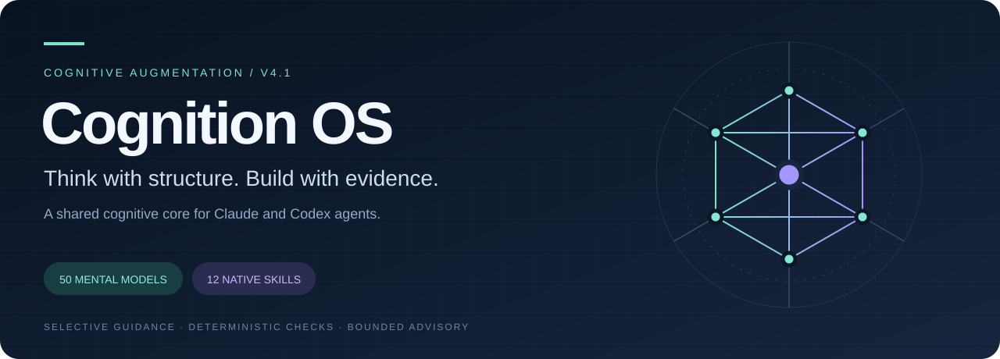

<p align="center">
  
</p>

<p align="center">
  <strong>Give your agent a richer analytical toolkit.</strong><br />
  From root causes to architecture decisions, bring structure and evidence into the work already underway.
</p>

<p align="center">
  <a href="docs/CONCEPT_V4_1.md"></a>
  <a href="plugin.json"></a>
  <a href="docs/REBUILD_STATUS_V4_1.md"></a>
  <a href="#capabilities"></a>
</p>

<p align="center">
  <a href="#how-it-works">How it works</a> ·
  <a href="#try-it">Try it</a> ·
  <a href="#install">Install</a> ·
  <a href="#contribute">Contribute</a> ·
  <a href="#project-status">Project status</a>
</p>

---

## Intelligence for the agent, outcomes for the user

Cognition OS equips agents in **Codex, Claude, Antigravity, GitHub Copilot, VS Code, OpenCode, Command Code, OpenClaw, Hermes, and other Agent Skills hosts** with a shared library of analytical methods. Give your host an ordinary task—debug a failure, assess a decision, or review a release. When it helps, the host can draw on a focused skill, a deterministic check, or deeper advisory guidance, then return to the work you asked it to do.

The host remains in charge of the task, tools, permissions, and final deliverable. Cognition OS does not require users to select frameworks or run a separate analysis application.

## How it works


These are the V4.1 design paths, not a claim that every host integration has passed native acceptance. Skill selection depends on the host model; hooks depend on the host's support, permissions, and trust controls. The project does not assume access to hidden reasoning or universal runtime interception.

## Capabilities

<table>
<tr>
<td width="50%" valign="top">
<h3>🧭 Find the right perspective</h3>
<p><strong>50 mental models · 8 categories</strong></p>
<p>Select complementary methods to uncover assumptions, map dependencies, and frame the real problem.</p>
<a href="docs/MENTAL_MODEL_REGISTRY.md">Explore the cognitive catalog →</a>
</td>
<td width="50%" valign="top">
<h3>🔬 Make evidence visible</h3>
<p><strong>Claims · Sources · Uncertainty</strong></p>
<p>Distinguish observations from hypotheses and calculations. Keep missing evidence visible in the result.</p>
<a href="docs/DECISION_PROVENANCE.md">Follow the evidence model →</a>
</td>
</tr>
<tr>
<td width="50%" valign="top">
<h3>⚙️ Check what can be checked</h3>
<p><strong>Calculations · Schemas · Artifacts</strong></p>
<p>Use deterministic helpers for quantitative work and narrow structural validation when inputs and permissions allow.</p>
<a href="docs/MATHEMATICAL_VALIDATION.md">Inspect the calculation methods →</a>
</td>
<td width="50%" valign="top">
<h3>🎯 Go deeper when it matters</h3>
<p><strong>Selective activation · Bounded advisory</strong></p>
<p>Bring in complementary viewpoints and adversarial review when complexity warrants it. Let simple tasks pass through.</p>
<a href="docs/HYBRID_ARCHITECTURE.md">Understand the activation design →</a>
</td>
</tr>
</table>

**12 native skills** expose the core to the host. **52 logical specialist definitions** organize analytical roles; they do not imply 52 running agents. Optional project memory and learning resources extend the toolkit without a required database, Docker service, or separate application.

## The toolkit at a glance

| Investigate | Decide & model | Review & communicate |
| :--- | :--- | :--- |
| [Root-cause analysis](skills/root-cause-analysis/SKILL.md) | [Strategic decision](skills/strategic-decision/SKILL.md) | [Adversarial review](skills/adversarial-review/SKILL.md) |
| [Systems analysis](skills/systems-analysis/SKILL.md) | [Quantitative decision](skills/quantitative-decision/SKILL.md) | [Artifact quality](skills/artifact-quality/SKILL.md) |
| [Framework composer](skills/framework-composer/SKILL.md) | [Cognition orchestrator](skills/cognition-orchestrator/SKILL.md) | [Executive synthesis](skills/executive-synthesis/SKILL.md) |

<details>
<summary><strong>Continuity, learning, and setup</strong></summary>

- [Case intelligence](skills/case-intelligence/SKILL.md) — authorized project knowledge reuse.
- [Cognitive mastery](skills/cognitive-mastery/SKILL.md) — optional human learning resources.
- [Setup](skills/setup/SKILL.md) — discover available capabilities and report gaps.

</details>

## Try it

Ask the supported agent host for the work you need. For example:

> Investigate this recurring service failure using the attached logs. Identify what the evidence supports, make the justified fix, and verify it.

> Compare these architecture options against our requirements. Explain the trade-offs and write a decision record.

> Review this release against its requirements and test evidence. Identify unresolved issues and give a supported readiness assessment.

A simple request such as “Rename this heading and preserve the rest of the file” should remain simple. Cognition OS is intended to assist the host, not insert a workflow into every task.

For installation or selection troubleshooting, use the [setup skill](skills/setup/SKILL.md), the [cross-host guide](docs/CROSS_HOST_COMPATIBILITY.md), and the host-specific tutorials below. Each host needs its own acceptance evidence.

## Install

Build the deterministic archives with `python scripts/package_release.py`, then follow the target guide:

| Host | Installation tutorial | Native form |
| --- | --- | --- |
| ChatGPT/Codex Desktop and Codex CLI | [Codex](docs/INSTALLATION_CODEX.md) | Agent Plugin marketplace/local source |
| Claude Desktop and Claude Code CLI | [Claude](docs/INSTALLATION_CLAUDE.md) | Claude plugin/account upload |
| Antigravity IDE and CLI | [Antigravity adapter](adapters/antigravity/README.md) | dedicated plugin archive |
| GitHub Copilot CLI and VS Code | [Cross-host guide](docs/CROSS_HOST_COMPATIBILITY.md) | plugin directory / VS Code plugin location |
| OpenCode | [OpenCode](docs/INSTALLATION_OPENCODE.md) | on-demand Agent Skills |
| Command Code | [Command Code](docs/INSTALLATION_COMMANDCODE.md) | external skills directory |
| OpenClaw | [OpenClaw](docs/INSTALLATION_OPENCLAW.md) | native `openclaw.plugin.json` bundle |
| Hermes Agent | [Hermes](docs/INSTALLATION_HERMES.md) | external on-demand skills directory |

The [desktop quick start](docs/DESKTOP_QUICKSTART.md) explains how to check installation separately from discovery, selection, execution, and task quality.

### Activation: automatic or explicit

You do **not** need to write `Cognition OS` or `[@Cognition OS](plugin://cognition-os@cognition-os-local)` in every prompt. On hosts that expose model-selected skills, Cognition OS can activate automatically when a skill description matches the task. A direct mention or slash command is useful for first-run testing, ambiguous prompts, critical work that needs deterministic routing, or hosts with a crowded skill catalog.

Automatic activation is host/model behavior, so installation alone cannot guarantee it. If a host omits skills because its discovery budget is full, disable unused plugins or invoke `cognition-orchestrator` explicitly.

### Suitable models

The plugin supports any tier when the host can discover skills and follow their contracts. Use current tool-capable instruct, reasoning, or coding families from OpenAI, Anthropic, Google, GitHub Copilot, xAI, DeepSeek, Mistral, Qwen/Alibaba, Meta Llama, MiniMax, Kimi, Z.AI, or a compatible local route such as Ollama/vLLM. Smaller models receive tighter sequential scaffolding; advanced models receive sparse guidance and independent challenge. See the complete [provider and model-family matrix](docs/MODEL_COMPATIBILITY.md).

Dependency-aware analysis is available through `python scripts/cognition.py analysis-plan`. It produces sequential, parallel, or hybrid execution waves without pretending that a host dispatched work. The active host runs independent steps concurrently only when native delegation and the authorized concurrency allowance are available.

Optional context validity checks use `memory-check`, stored-case `memory` checks, `evidence-snapshot`, and `decision-impact` to identify stale facts or changed assumptions before reusing knowledge. Existing cases remain readable; checks are read-only and matched conditions do not certify truth. See [CONTEXT_VALIDITY.md](docs/CONTEXT_VALIDITY.md) for input contracts, limits and the separate native evaluation gate.

Governed self-improvement is available through `python scripts/cognition.py improvement`. The project ledger records observation, proposal, baseline-versus-candidate evaluation, explicit approval, versioned deployment evidence, and rollback. See [SELF_IMPROVEMENT.md](docs/SELF_IMPROVEMENT.md).

Tier-adaptive capability amplification is available through `capability-plan`. It uses observed context, tools, and delegation capacity to give constrained models tighter sequential scaffolding and advanced models sparse, challenge-oriented workflows. `capability-eval` permits a significant-improvement claim only after paired sample-size, effect-size, statistical, and critical-regression gates pass. See [CAPABILITY_AMPLIFICATION.md](docs/CAPABILITY_AMPLIFICATION.md).

Token-aware progressive disclosure is available through `token-plan`. It selects LEAN, BALANCED, or DEEP context while enforcing a deterministic quality floor and escalation triggers. `token-eval` allows a retained-quality savings claim only when paired measured usage and rubric scores pass both gates. See [TOKEN_EFFICIENCY.md](docs/TOKEN_EFFICIENCY.md).

This repository is an engineering candidate. Installation does not itself establish hook trust, native event delivery, skill selection, or improved task outcomes. Review the current [V4.1 rebuild report](docs/REBUILD_STATUS_V4_1.md) before evaluating it.

## Contribute

### Build the next layer with us

**Good contributions start with a useful question, a clear change, and evidence.** You do not need to work on the entire system to make a meaningful contribution.

| Your interest | A useful starting point |
| :--- | :--- |
| Agent workflows | Refine a skill's inputs, procedure, or completion criteria |
| Python & mathematics | Improve helper correctness, edge cases, or numerical validation |
| Host integration | Document reproducible discovery, activation, permission, and concurrency behavior across supported clients |
| Evaluation & research | Design realistic tasks, negative controls, and fair comparisons |
| Technical writing | Clarify a guide, improve an example, or fix a broken reference |

<p align="center">
  <a href="https://github.com/azoghry-commits/Cognition-OS/issues"><strong>Explore issues</strong></a> ·
  <a href="https://github.com/azoghry-commits/Cognition-OS/issues/new"><strong>Propose an idea</strong></a> ·
  <a href="https://github.com/azoghry-commits/Cognition-OS/pulls"><strong>Review pull requests</strong></a>
</p>

We welcome contributions that make Cognition OS more useful, reliable, and honest about its evidence. You can propose a focused improvement to a skill, framework, adapter, schema, helper, evaluation, or documentation.

<details open>
<summary><strong>Contribution standards & review process</strong></summary>


1. Open or link an issue for substantial changes. Describe the user or agent problem, proposed behavior, and how success can be observed.
2. Keep changes focused and compatible with the shared core and host-owned workflow. Explain any changes to contracts, activation, permissions, or persistence.
3. Include relevant tests or reproducible evidence for behavior changes. For documentation-only edits, explain which existing behavior or source the change clarifies.
4. Preserve provenance: distinguish source requirements from engineering choices, and never present simulated, authored, or structural checks as observed host results.
5. Do not include credentials, private user data, machine-specific state, generated packages, or unrelated files.
6. Submit a pull request with a clear summary, validation performed, and any remaining limitations. Be responsive to review and revise the contribution when needed.

Contributions are reviewed for scope, correctness, security, maintainability, and evidence quality. A submission is not accepted until a maintainer approves and merges it. Please discuss changes that introduce new dependencies, alter security boundaries, or change the V4.1 design before investing in a large implementation.

**Licensing and distribution are still project gates.** The repository currently does not declare an open-source license. Before contributing code, please open an issue to discuss the proposed contribution and its licensing; do not assume that a pull request grants permission to redistribute your work. See the [release checklist](docs/RELEASE_CHECKLIST.md).

</details>

## Project status

The **V4.1 package candidate is implemented and locally checked**. Native acceptance and production readiness are still in progress. In particular, actual model selection, hook trust and delivery, behavioral fidelity, and comparative host outcomes need host-level evidence. No task-quality improvement claim is made here.

| Area | Current evidence boundary |
| --- | --- |
| Shared core and package | Catalog, contracts, adapters, helpers, and package checks are recorded in the rebuild report |
| Routing | Authored deterministic cases check the activation rules; they are not observed model choices |
| Cross-host package | Codex, Claude, Antigravity, Copilot, VS Code, OpenCode, Command Code, OpenClaw, and Hermes have separate acceptance requirements; evidence on one does not certify another |
| Comparative outcomes | A/B/C/D host evaluation and measured quality, overhead, and latency remain open |
| Release | Licensing and distribution approval remain open gates |

Read the [rebuild status](docs/REBUILD_STATUS_V4_1.md), [platform verification](docs/PLATFORM_VERIFICATION_V4_1.md), [migration plan](docs/V4_1_MIGRATION_PLAN.md), and [changelog](CHANGELOG.md) for details. The retired blueprint and strategic PDF are no longer required by the build or distributed repository; the canonical generated catalog and provenance fields remain.

## Development

Python 3.10+ is used by the local helper and rebuild pipeline. From the repository root, common checks are:

```powershell
uv sync --locked --extra dev
uv run --locked --extra dev pip-audit --progress-spinner off
uv run --locked --extra dev ruff check cognition scripts tests
uv run --locked --extra dev mypy cognition
uv run --locked --extra dev coverage run -m unittest discover -s tests -q
uv run --locked --extra dev coverage report --fail-under=80
uv run --locked --extra dev coverage xml
uv run --locked --extra dev python scripts/validate_package.py
uv run --locked --extra dev python scripts/package_release.py
```

These are local structural and deterministic checks. They do not certify native host behavior or publish a release. See the [test plan](docs/TEST_PLAN.md) and [release checklist](docs/RELEASE_CHECKLIST.md).

For a reproducible editor environment, open the repository in a Dev Container. It pins Python 3.13 and runs the locked development install automatically. Contributions should follow the focused change and paired-test workflow in [CONTRIBUTING.md](CONTRIBUTING.md).

<details>
<summary><strong>Repository map — where everything lives</strong></summary>

```text
.agents/ .claude-plugin/ .codex-plugin/  Host and marketplace manifests
adapters/ hooks/                         Host-specific packaging and integration
cognition/ cognitive-core/               Runtime helpers and shared catalog
skills/ references/ templates/           Agent guidance and reusable artifacts
schemas/ tests/                           Contracts and verification
docs/                                     Architecture, guides, and audit records
scripts/ assets/                          Build tools and project identity
```

</details>

---

<p align="center">
  <br /><br />
  <strong>One cognitive core. Native host execution. Evidence before confidence.</strong>
</p>

## Development and measured scaffolding

See [development workflow](docs/DEVELOPMENT.md), [development log](docs/DEVELOPMENT_LOG.md), [installation index](docs/INSTALLATION.md), and [measured scaffolding analysis](docs/MEASURED_SCAFFOLDING_ANALYSIS.md). The offline `scaffolding-select` helper recommends a strategy from supplied paired scores. Real host calibration and automatic activation remain pending.
