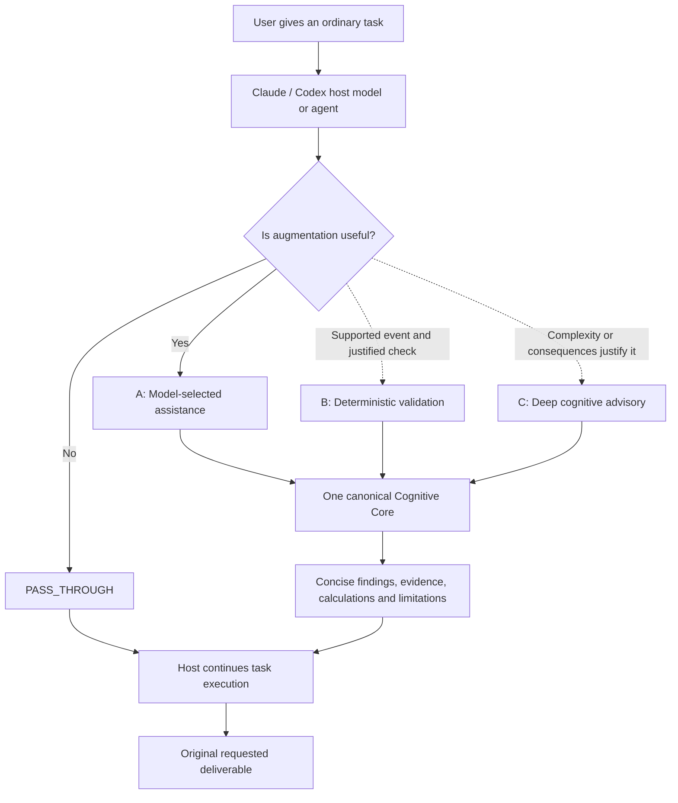

<p align="center">
  
</p>

<h1 align="center">Cognition OS</h1>

<p align="center">
  <strong>Hybrid Agent Cognitive Augmentation Layer</strong><br />
  One cognitive core. Native host execution. Evidence before confidence.
</p>

<p align="center">
  <a href="docs/CONCEPT_V4_1.md"></a>
  <a href="#verification-status"></a>
  <a href="#core-capabilities"></a>
  <a href="#core-capabilities"></a>
</p>

<p align="center">
  <strong>Built for the models and agents working inside Claude and Codex.</strong><br />
  Humans give the task. The host selects useful capabilities and delivers the result.
</p>

<p align="center">
  <a href="#how-it-works">How it works</a> &middot;
  <a href="#example-prompts">Example prompts</a> &middot;
  <a href="#chatgpt-desktop-and-codex">Desktop guide</a> &middot;
  <a href="#verification-status">Verification</a> &middot;
  <a href="#repository-map">Repository map</a>
</p>

---

## What Cognition OS is

Cognition OS supplies cognitive capabilities to **host models and agents**. A person asks Claude or Codex to investigate a failure, implement a change, compare designs, or review a release. The host can select relevant Cognition OS guidance, calculations, and checks while doing that work.

The host remains responsible for the objective, tools, permissions, execution, and final deliverable. Cognition OS returns useful findings to the host, which incorporates them into the requested result. Users should not need to open another application, choose mental models, or manage a separate analysis workflow.

**The V4.1 rebuild is available as package candidate 0.2.0 and installed/enabled in the authorized local Codex marketplace.** It implements a selective governor, V4.1 advisory contracts, bounded deep-advisory plans, 12 model-facing skills, and separate Codex/Claude hook configurations. Legacy framework artifacts retain the 3.1 contract with explicit advisory conversion. Native model selection, trusted hook delivery, and host A/B/C/D outcomes remain unverified. Package versions are independent of specification versions; see the [rebuild status](docs/REBUILD_STATUS_V4_1.md) and [package identity](plugin.json).

Read the [V4.1 concept review](docs/CONCEPT_V4_1.md), [migration plan](docs/V4_1_MIGRATION_PLAN.md), and [complete specification](docs/evidence/master-implementation-prompt-v4.1.txt) for the engineering requirements. This README is in English; supporting engineering documentation is primarily in Indonesian.

## How it works

The target architecture provides three complementary paths. Each invocation must have a task-relevant purpose and fit the host's execution budget.

| Path | When the host uses it | Contribution |
| --- | --- | --- |
| **A · Model-selected assistance** | A relevant skill can improve the current work | Selected framework guidance and concise analytical findings; the primary path |
| **B · Event-driven deterministic validation** | A supported, authorized event exposes enough information for a narrow check | Repeatable artifact, format, or schema checks; no unconditional model call |
| **C · Conditional deep advisory** | Complexity, uncertainty, contradictory evidence, or consequences justify deeper work | Complementary frameworks, bounded adversarial review, and quantitative analysis when inputs exist |

The diagram below represents the **V4.1 target**, rather than certification that every path has passed native host testing.



The paths can be combined when each adds value. A simple edit may need none of them. Model selection is probabilistic: installing skills does not guarantee invocation, and the plugin does not assume access to hidden reasoning or every stage of the host's runtime.

## Core capabilities

The rebuilt catalog, routing and helpers implement the local V4.1 candidate. Their presence is separate from evidence that hybrid behavior works in a particular host.

| Capability | What it contributes | Scope |
| --- | --- | --- |
| **50 mental models across eight categories** | Distinctive methodologies, required inputs, expected outputs, and validation criteria | Canonical definitions loaded selectively |
| **52 logical specialist definitions** | AG-01 through AG-50, AG-51 Chief Orchestrator, and AG-52 Evaluator Jury | Logical analytical roles; native subagents only when supported and useful |
| **12 focused native skills** | Routing, root-cause analysis, framework composition, decisions, systems analysis, adversarial/artifact review, synthesis, optional cases/learning and setup | Model-facing capability entrypoints; setup remains a diagnostic tool |
| **Framework routing** | Selects a small complementary set and checks dependencies, missing inputs, and duplicate analysis | Seven internal policies including `PASS_THROUGH`, configurable budgets, no automatic dispatch |
| **Native hook adapters** | Optional PostToolUse schema checks for explicitly edited `.cognition/artifacts` JSON | Separate configurations; bounded read-only scripts; host trust and native delivery still need evaluation |
| **Deterministic computation** | Expected value, Bayes, RICE, decision matrices, Monte Carlo, sensitivity, Pareto, CPM, and stock-and-flow | Requires explicit inputs, units, assumptions, and permitted execution |
| **Evidence and logic checks** | Claim classification, finite-universe MECE checks, artifact contracts, and observable decision provenance | Structural checks and semantic judgment remain distinct |
| **Adversarial evaluation** | Constructive advocate, critical challenger, and a jury that can withhold endorsement | Bounded, conditional analysis that preserves unresolved disagreement |
| **Optional knowledge reuse** | Project-scoped cases and governed improvement proposals | Explicitly authorized local storage; no mandatory database server |
| **Optional Human Mastery Track** | Framework lessons, exercises, and the source-derived learning direction | Separate human learning capability; no claim of model retraining |

The core preserves the source catalog without running all frameworks or launching all specialists for each task. See the [mental-model registry](docs/MENTAL_MODEL_REGISTRY.md), [logical specialist registry](docs/AGENT_REGISTRY.md), and [mathematical validation guide](docs/MATHEMATICAL_VALIDATION.md).

## Example prompts

### Ordinary tasks

In the intended V4.1 workflow, the user asks for the actual result. The host decides whether cognitive assistance is relevant; these examples are evaluation targets, not guarantees of automatic activation.

**Investigate and fix a failure**

```text
Investigate the recurring database failures using the attached logs and configuration.
Identify what the evidence supports, implement the justified fix, and verify the result.
```

**Compare architecture alternatives**

```text
Compare these two retry architectures against our throughput and recovery requirements.
Evaluate the trade-offs and failure modes, then write the architecture decision record.
```

**Review release readiness**

```text
Review this release against its requirements and test evidence.
Identify unresolved defects and missing checks, then give a supported readiness assessment.
```

**Check a quantitative decision**

```text
Compare these options using the supplied probabilities, payoffs, costs, and units.
Show the calculations and what assumptions could change the recommendation.
```

A request such as "Rename this heading and preserve the rest of the file" is a useful negative control: the host should be able to complete it without an unnecessary cognitive workflow.

### Explicit diagnostic fallback

Manual invocation helps investigate discovery or selection failures. It is not the intended everyday operating requirement.

```text
Use Cognition OS setup to check which capabilities are available in this chat.
Report what you actually inspected and which checks remain unverified.
```

```text
Use Cognition OS root-cause analysis for recurring MariaDB failures.
No logs or unaffected comparison systems have been supplied.
Identify the evidence gaps and safe diagnostic checks without asserting a verified cause.
```

## ChatGPT Desktop and Codex

The recorded local development target is **ChatGPT Desktop on Windows using Codex**. Baseline installation and cache integrity have been recorded; fresh-chat desktop activation and analytical behavior require their own evidence.

1. Follow the [Desktop quick start](docs/DESKTOP_QUICKSTART.md) and [Codex installation guide](docs/INSTALLATION_CODEX.md) for the reviewed local package.
2. Refresh the desktop host after an installation or update, then open a fresh supported Codex or local Work chat.
3. In the native plugin interface, locate the local **Cognition OS** package and confirm its installed/enabled state. Check the installed version against the package you intend to test.
4. Run the setup diagnostic to check access to packaged resources and available calculation tools. Record observed successes and missing capabilities.
5. Give the host an ordinary task from the examples above. Evaluate whether it selects a useful capability and still produces the requested deliverable. Also test a simple task where augmentation should remain passive.

Installation, discovery, model selection, script execution, and quality of the resulting work are separate checks. CLI results do not certify desktop behavior. Optional hook execution also depends on host support, script availability, and the host's trust and permission controls; package presence alone is insufficient.

Claude has its own [installation guide](docs/INSTALLATION_CLAUDE.md) and must be evaluated independently. The [platform compatibility matrix](docs/PLATFORM_COMPATIBILITY.md) records surface-specific findings; the [account scope](docs/ACCOUNT_SCOPE.md) records the authorized validation route.

## Architecture

**One unified Cognitive Core, with separate Claude and Codex native adapters.** The host provides reasoning and execution. Skills provide selectively loaded procedures; deterministic helpers check structures and perform calculations. Optional native events can trigger narrowly scoped validation where supported.

| Layer | Responsibility |
| --- | --- |
| **Host model / agent** | Interpret the user's task, select capabilities, enforce permissions, execute work, and deliver the result |
| **Native adapters** | Package and expose the shared capabilities using each host's supported integration points |
| **Hybrid activation policy** | Choose pass-through, lightweight assistance, deterministic validation, or justified deeper review |
| **Canonical Cognitive Core** | Preserve frameworks, logical specialists, workflow rules, evidence requirements, and provenance |
| **Local deterministic helpers** | Calculate and validate from supplied inputs; report errors and limitations explicitly |
| **Optional continuity** | Reuse authorized cases and retain versioned improvement proposals |

The seven V4.1 policies are internal coordination choices: `PASS_THROUGH`, `LIGHT_AUGMENTATION`, `STANDARD_AUGMENTATION`, `DETERMINISTIC_VALIDATION`, `DEEP_ADVISORY`, `CRITICAL_REVIEW`, and `DEGRADED`. Users should not have to choose a mode before asking for work.

MCP remains optional. The baseline must work without a remote service, separate application, Docker stack, database server, or new model API credential. Native subagents are an execution option when available, authorized, and useful; logical role definitions do not imply concurrent model processes.

See the [V4.1 hybrid architecture](docs/HYBRID_ARCHITECTURE.md), [source transformation audit](docs/SOURCE_TRANSFORMATION_V4_1.md), [platform verification](docs/PLATFORM_VERIFICATION_V4_1.md), and [architecture decisions](docs/ARCHITECTURE_DECISIONS.md).

## Verification status

**Local rebuild checks pass. Native acceptance and production readiness remain incomplete.**

The recorded baseline package 0.1.0 predates the V4.1 migration. Its results remain historical evidence and do not certify unfinished migration code or native hybrid behavior.

| Area | Recorded evidence | Remaining qualification |
| --- | --- | --- |
| **Source preservation and catalog** | Source hashes, 50 framework contracts, eight categories, and 52 logical roles recorded in the baseline audit | Contract coverage does not prove methodological fidelity in host-generated answers |
| **Baseline automated checks** | October 20, 2026 record: 56 checks, 55 passed, one skipped because the OS denied test symlink creation | These are baseline results; migration changes require their own fresh test evidence |
| **V4.1 automated checks** | 85 tests: 83 passed, two symlink checks skipped under Windows permissions; full schema validation and extracted-package helper/hook execution | Local checks do not prove native model selection or event delivery |
| **Routing evaluation** | 16 deterministic cases passed, including negative controls and required-check failure handling | Fixture context labels are authored; these are not observed model choices |
| **Native integration** | Codex 0.2.0 installed/enabled; installed inventory and deterministic helper verified; rollback 0.1.0 retained | Fresh-chat desktop skill selection, invocation, and end-to-end behavior remain separate gates |
| **Local calculation timing** | Helper-only benchmark recorded separately | Excludes model latency, skill selection, token overhead, and improvement in user-task outcomes |
| **V4.1 hybrid behavior** | Governor, contracts, deep plans and hook adapters are implemented and locally checked | Native skill invocation, trust/permission behavior and host outcome improvement still need evidence |
| **Cross-host readiness** | Separate adapter documentation and baseline compatibility findings exist | Passing one host or surface does not establish equivalent behavior elsewhere |

V4.1 requires the following comparison, using equivalent tasks and recorded host/model settings:

| Configuration | Experiment |
| --- | --- |
| **A — Baseline** | Host without Cognition OS |
| **B — Model-selected only** | Host with cognitive skills available |
| **C — Skills plus checks** | B plus applicable deterministic hooks |
| **D — Full hybrid** | C plus selectively activated deep advisory |

Measure task correctness, requirement coverage, regressions, selection relevance, unnecessary activation, false-positive warnings, calls, token overhead, latency, artifact quality, and error recovery where observable. Include negative controls. Missing instrumentation is unavailable data, not zero overhead. No completed native A/B/C/D improvement result is claimed here.

Current evidence and gates: [rebuild report](docs/REBUILD_STATUS_V4_1.md), [routing results](docs/evidence/v4-1-activation-evals.json), [platform verification](docs/PLATFORM_VERIFICATION_V4_1.md), and [project status](docs/PROJECT_STATUS.md). Historical baseline checks and helper timings remain in their original reports.

## Boundaries and limitations

- **Host ownership:** preserve the user's objective, authorized scope, constraints, and requested output. Advisory findings do not replace the original deliverable.
- **Selective activation:** avoid duplicate analysis, unnecessary specialist calls, and deep advisory without a useful analytical question.
- **Supported integration only:** no hidden reasoning access, universal runtime interception, guaranteed skill invocation, or assumed hook enforcement.
- **Evidence discipline:** distinguish source-supported statements, observations, assumptions, inferences, hypotheses, calculations, simulations, and unknowns. Do not invent calibrated confidence scores.
- **Honest validation:** a schema pass, numerical result, or model-generated quality score does not establish factual truth, causal certainty, security, or release readiness.
- **Explicit recovery:** report failed checks and unavailable components. Optional advisory failures may degrade gracefully; required security enforcement follows the host's verified permission behavior.
- **Controlled persistence:** project cases require explicit authorization. The baseline stores plain local JSON and provides no encryption guarantee or secrets vault.
- **Governed evolution:** changes to trusted instructions require review, testing, approval, versioning, and rollback; stored cases do not retrain the host model.
- **Distribution scope:** source documents are retained for traceability and excluded from installable runtime archives. Source licensing and distribution approval remain recorded release gates.

## Development

Python 3.10+ supports the local helper and rebuild pipeline. The generators now produce the V4.1 candidate and preserve historical audit records. Rebuilding neither installs the package nor changes host trust or permissions.

Typical local verification and packaging entrypoints are:

```powershell
python scripts/rebuild_plugin.py
python scripts/verify_rebuild.py
python -m unittest discover -s tests -v
python scripts/evaluate_activation.py
python scripts/validate_package.py
python scripts/package_release.py
```

These commands are development checks. Packaging does not install the plugin, trust hooks, publish a release, or prove native model selection. Keep native evaluation transcripts and measured results separate from structural test evidence.

## Repository map

The repository keeps one cognitive catalog shared by both adapters. Migration work is introduced alongside existing contracts so that compatibility can be reviewed explicitly.

```text
cognition-os/
|-- plugin.json                    Portable package identity and OpenAI extension
|-- .claude-plugin/                Claude manifest and local marketplace metadata
|-- .codex-plugin/                 Codex compatibility manifest
|-- .agents/plugins/               Repository-local marketplace metadata
|-- assets/                        Shared logo and visual assets
|-- skills/                        Model-consumable workflows and setup diagnostics
|-- cognitive-core/
|   |-- frameworks/                Canonical registry and 50 method definitions
|   |-- agents/                    52 logical specialist definitions
|   |-- orchestration/             Existing bounded workflow policy
|   |-- augmentation/              V4.1 activation policy work
|   `-- mastery/                   Optional human learning curriculum
|-- cognition/                     Local calculations, validation, routing and cases
|-- schemas/                       Versioned data contracts and payload schemas
|-- references/                    Selectively loaded execution and method guidance
|-- templates/                     Optional analytical and decision artifacts
|-- adapters/                      Claude and Codex integration notes
|-- scripts/                       Generators, helpers, checks and packaging
|-- tests/                         Contracts, mathematics, governance and migration checks
|-- docs/                          Architecture, migration, installation and release records
|   `-- evidence/                  Source provenance and recorded verification evidence
|-- README.md
`-- CHANGELOG.md
```

| Start here | Purpose |
| --- | --- |
| [V4.1 concept review](docs/CONCEPT_V4_1.md) | Understand the shift to a host-agent augmentation layer |
| [Migration plan](docs/V4_1_MIGRATION_PLAN.md) | Follow Phase 0–8 deliverables and acceptance gates |
| [Source audit](docs/SOURCE_ANALYSIS.md) | Inspect source coverage, transformations, and inconsistencies |
| [Desktop quick start](docs/DESKTOP_QUICKSTART.md) | Check local installation and native activation separately |
| [Project status](docs/PROJECT_STATUS.md) | Review recorded progress, limitations, and next gates |
| [Changelog](CHANGELOG.md) | Track versioned changes |

---

<p align="center">
  <strong>Hybrid intelligence. Native execution. Measurable improvement.</strong><br />
  Useful assistance for the host agent. Evidence for every readiness claim.
</p>
