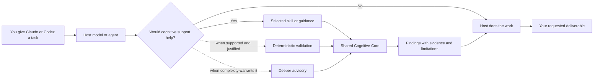

<p align="center">
  
</p>

<h1 align="center">Cognition OS</h1>

<p align="center">
  <strong>A cognitive augmentation layer for the agents doing the work.</strong><br />
  One shared core for Claude and Codex. Selective guidance, deterministic checks, evidence-led results.
</p>

<p align="center">
  <a href="docs/CONCEPT_V4_1.md"></a>
  <a href="plugin.json"></a>
  <a href="docs/REBUILD_STATUS_V4_1.md"></a>
  <a href="#capabilities"></a>
</p>

<p align="center">
  <a href="#how-it-works">How it works</a> ·
  <a href="#try-it">Try it</a> ·
  <a href="#install">Install</a> ·
  <a href="#contribute">Contribute</a> ·
  <a href="#project-status">Project status</a>
</p>

---

## Intelligence for the agent, outcomes for the user

Cognition OS equips the **models and agents inside Claude and Codex** with a shared library of analytical methods. Give your host an ordinary task—debug a failure, assess a decision, or review a release. When it helps, the host can draw on a focused skill, a deterministic check, or deeper advisory guidance, then return to the work you asked it to do.

The host remains in charge of the task, tools, permissions, and final deliverable. Cognition OS does not require users to select frameworks or run a separate analysis application.

## How it works



These are the V4.1 design paths, not a claim that every host integration has passed native acceptance. Skill selection depends on the host model; hooks depend on the host's support, permissions, and trust controls. The project does not assume access to hidden reasoning or universal runtime interception.

## Capabilities

- **50 mental models** with defined methods, inputs, outputs, and validation criteria.
- **52 logical specialist roles** for structured analysis; these definitions do not imply 52 running agents.
- **12 model-facing skills** for orchestration, root-cause analysis, decisions, systems analysis, quantitative work, review, synthesis, and setup diagnostics.
- **Selective activation** to keep simple tasks simple and avoid redundant analysis.
- **Deterministic calculations and artifact checks** when the task, inputs, host permissions, and supported integration justify them.
- **Evidence discipline** that distinguishes observations, assumptions, inferences, hypotheses, calculations, and unknowns.
- **Optional project memory and learning material**, with no required database, Docker service, or separate application.

Explore the [architecture](docs/ARCHITECTURE.md), [V4.1 design](docs/HYBRID_ARCHITECTURE.md), [mental-model registry](docs/MENTAL_MODEL_REGISTRY.md), and [specialist registry](docs/AGENT_REGISTRY.md).

## Try it

Ask Claude or Codex for the work you need. For example:

> Investigate this recurring service failure using the attached logs. Identify what the evidence supports, make the justified fix, and verify it.

> Compare these architecture options against our requirements. Explain the trade-offs and write a decision record.

> Review this release against its requirements and test evidence. Identify unresolved issues and give a supported readiness assessment.

A simple request such as “Rename this heading and preserve the rest of the file” should remain simple. Cognition OS is intended to assist the host, not insert a workflow into every task.

For installation or selection troubleshooting, use the [setup skill](skills/setup/SKILL.md) and follow the host-specific guides: [Codex](docs/INSTALLATION_CODEX.md) and [Claude](docs/INSTALLATION_CLAUDE.md). Each host needs its own acceptance evidence.

## Install

Use the [Codex installation guide](docs/INSTALLATION_CODEX.md) or the [Claude installation guide](docs/INSTALLATION_CLAUDE.md) for the reviewed local package and host-specific steps. The [desktop quick start](docs/DESKTOP_QUICKSTART.md) explains how to check installation separately from skill selection and task behavior.

This repository is an engineering candidate. Installation does not itself establish hook trust, native event delivery, skill selection, or improved task outcomes. Review the current [V4.1 rebuild report](docs/REBUILD_STATUS_V4_1.md) before evaluating it.

## Contribute

We welcome contributions that make Cognition OS more useful, reliable, and honest about its evidence. You can propose a focused improvement to a skill, framework, adapter, schema, helper, evaluation, or documentation.

**Contributor requirements**

1. Open or link an issue for substantial changes. Describe the user or agent problem, proposed behavior, and how success can be observed.
2. Keep changes focused and compatible with the shared core and host-owned workflow. Explain any changes to contracts, activation, permissions, or persistence.
3. Include relevant tests or reproducible evidence for behavior changes. For documentation-only edits, explain which existing behavior or source the change clarifies.
4. Preserve provenance: distinguish source requirements from engineering choices, and never present simulated, authored, or structural checks as observed host results.
5. Do not include credentials, private user data, machine-specific state, generated packages, or unrelated files.
6. Submit a pull request with a clear summary, validation performed, and any remaining limitations. Be responsive to review and revise the contribution when needed.

Contributions are reviewed for scope, correctness, security, maintainability, and evidence quality. A submission is not accepted until a maintainer approves and merges it. Please discuss changes that introduce new dependencies, alter security boundaries, or change the V4.1 design before investing in a large implementation.

**Licensing and distribution are still project gates.** The repository currently does not declare an open-source license. Before contributing code, please open an issue to discuss the proposed contribution and its licensing; do not assume that a pull request grants permission to redistribute your work. See the [release checklist](docs/RELEASE_CHECKLIST.md).

## Project status

The **V4.1 package candidate is implemented and locally checked**. Native acceptance and production readiness are still in progress. In particular, actual model selection, hook trust and delivery, behavioral fidelity, and comparative host outcomes need host-level evidence. No task-quality improvement claim is made here.

| Area | Current evidence boundary |
| --- | --- |
| Shared core and package | Catalog, contracts, adapters, helpers, and package checks are recorded in the rebuild report |
| Routing | Authored deterministic cases check the activation rules; they are not observed model choices |
| Codex and Claude | Each host has separate installation and acceptance requirements; evidence on one does not certify the other |
| Comparative outcomes | A/B/C/D host evaluation and measured quality, overhead, and latency remain open |
| Release | Licensing and distribution approval remain open gates |

Read the [rebuild status](docs/REBUILD_STATUS_V4_1.md), [platform verification](docs/PLATFORM_VERIFICATION_V4_1.md), [migration plan](docs/V4_1_MIGRATION_PLAN.md), and [changelog](CHANGELOG.md) for details. Maintained documentation is in English. Original source materials and preserved evidence retain their original bytes and language for traceability.

## Development

Python 3.10+ is used by the local helper and rebuild pipeline. From the repository root, common checks are:

```powershell
python scripts/rebuild_plugin.py
python scripts/verify_rebuild.py
python -m unittest discover -s tests -v
python scripts/evaluate_activation.py
python scripts/validate_package.py
```

These are local structural and deterministic checks. They do not certify native host behavior or publish a release. See the [test plan](docs/TEST_PLAN.md) and [release checklist](docs/RELEASE_CHECKLIST.md).

## Repository layout

```text
.agents/ .claude-plugin/ .codex-plugin/  Host and marketplace manifests
adapters/ hooks/                         Claude and Codex integration
cognition/ cognitive-core/               Runtime helpers and shared catalog
skills/ references/ templates/           Agent guidance and reusable artifacts
schemas/ tests/                           Contracts and verification
docs/                                     Architecture, guides, and audit records
scripts/ assets/                          Build tools and project identity
```

---

<p align="center">
  <strong>One cognitive core. Native host execution. Evidence before confidence.</strong>
</p>
