<p align="center">
  
</p>

<h1 align="center">Cognition OS</h1>

<p align="center"><strong>Evidence-grounded cognitive workflows for native AI hosts</strong></p>

<p align="center">
  <a href="#release-status"></a>
  <a href="#the-cognitive-core"></a>
  <a href="#the-cognitive-core"></a>
  <a href="docs/TEST_REPORT.md"></a>
</p>

<p align="center"><strong>Turn ambiguous decisions into structured, evidence-aware analysis — without a separate web app, server, database, or model API.</strong></p>

---

## Why Cognition OS?

Most difficult decisions fail long before the final recommendation: the problem is framed poorly, evidence is mixed with assumptions, calculations lose their units, and criticism arrives too late. Cognition OS packages disciplined ways of thinking into native skills for supported AI hosts.

It helps a host move from an initial question to a bounded plan, explicit evidence, framework artifacts, deterministic calculations where appropriate, and a decision record that can be reviewed later.

| From | To |
| --- | --- |
| “Why is this happening?” | Root-cause work with Kepner–Tregoe, issue trees, and evidence gaps |
| “Which option should we choose?” | Criteria, trade-offs, expected value, scenarios, and decision records |
| “What might this system do next?” | Feedback loops, causal structure, constraints, and sensitivity analysis |
| “Can we trust this recommendation?” | Provenance, MECE checks, an adversarial review path, and a reject-capable jury |

## The cognitive core

One canonical catalog powers every host adapter. It preserves the supplied source identities while keeping delivery native and lightweight.

| Component | What it provides |
| --- | --- |
| **50 mental models** | Framework-specific procedures, input/output contracts, and lazy-loaded definitions |
| **52 logical specialist roles** | Stable analytical roles for orchestration; these are definitions, not 52 permanently running agents |
| **11 focused skills** | Setup, orchestration, root-cause analysis, strategic and quantitative decisions, systems analysis, review, synthesis, cases, and mastery |
| **Deterministic helpers** | Expected value, Bayes, RICE, decision matrices, Monte Carlo, CPM, Pareto, sensitivity, stock-and-flow, and more |
| **Evidence safeguards** | Typed artifacts, provenance DAG validation, exact finite-universe MECE checks, and explicit missing-evidence handling |
| **Optional continuity** | Project-scoped JSON cases and a 90-day learning curriculum, only when explicitly requested |

```mermaid
flowchart LR
    Q[Question or decision] --> I[Structured intake]
    I --> O[Native orchestration]
    O --> F[Selected framework definitions]
    F --> A[Evidence-bound artifacts]
    A --> C[Validated calculations]
    C --> R[Adversarial review / jury]
    R --> D[Decision record and next actions]
    D -. explicit opt-in .-> M[Project cases and mastery]
```



## What it does differently

- **Progressive disclosure:** load the relevant framework rather than placing the whole catalog in every prompt.
- **Evidence before confidence:** an observation, inference, assumption, and unknown remain distinct.
- **Math with guardrails:** calculations require declared inputs, methods, outputs, and units; helpers do not invent findings.
- **A real rejection path:** critical evidence or governance failures can block a recommendation.
- **Portable by design:** no required MCP server, hook, database, Docker service, credential, or external model API.

## Use it in ChatGPT Desktop / Codex

This repository's primary tested installation target is **ChatGPT Desktop on Windows with Codex**. The package has been installed and enabled through the local Codex route, while desktop skill activation still requires confirmation in a fresh native chat.

1. Restart ChatGPT Desktop to refresh local plugin discovery.
2. Open a new Codex or supported local Work chat.
3. Open **Plugins Directory**, select **Cognition OS local**, and confirm **Cognition OS** is installed and enabled.
4. Select the **setup** skill, or ask:

   ```text
   Use Cognition OS setup and check which capabilities are available in this chat.
   ```

5. Try a bounded request:

   ```text
   Use Cognition OS and Kepner-Tregoe to analyze recurring MariaDB failures.
   No logs have been supplied yet.
   ```

The expected response is a structured request for missing evidence and safe checks, not an invented root cause.

For exact local marketplace, update, and rollback steps, read the [ChatGPT Desktop quick start](docs/DESKTOP_QUICKSTART.md) and [Codex installation guide](docs/INSTALLATION_CODEX.md).

## Example prompts

<details>
<summary><strong>Diagnose an operational problem</strong></summary>

```text
Use Cognition OS root-cause analysis. Define the deviation, distinguish IS from IS NOT,
list missing evidence, and propose only safe discriminating checks. Do not claim a cause
unless the evidence supports it.
```
</details>

<details>
<summary><strong>Choose between alternatives</strong></summary>

```text
Use Cognition OS quantitative decision. Compare these options with explicit criteria,
weights, units, assumptions, expected value, and a sensitivity check. Separate facts from
estimates and flag what would change the recommendation.
```
</details>

<details>
<summary><strong>Challenge a recommendation</strong></summary>

```text
Use Cognition OS adversarial review. Audit this proposed decision for unsupported claims,
missing evidence, hidden assumptions, measurement gaps, and failure modes. Reject it when
critical requirements are unmet.
```
</details>

## Architecture at a glance

```text
Native host
  └─ focused skills (11)
       └─ shared cognitive core
            ├─ framework registry (50)
            ├─ logical role registry (52)
            ├─ schemas and bounded workflow policy
            ├─ optional local deterministic helpers
            └─ evidence, provenance, review, memory, and mastery resources
```

The [architecture guide](docs/ARCHITECTURE.md) explains the layers. See the [mental-model registry](docs/MENTAL_MODEL_REGISTRY.md), [agent registry](docs/AGENT_REGISTRY.md), and [data contracts](docs/DATA_CONTRACTS.md) for inspectable detail.

## Development and verification

Requires Python 3.10+ for local build and validation work.

```powershell
python scripts/build_catalog.py
python scripts/build_plugin.py
python scripts/build_docs.py
python -m unittest discover -s tests -v
python scripts/validate_package.py
python scripts/benchmark.py
python scripts/package_release.py
```

The generated runtime and marketplace archives are deterministic, hash-checked, and exclude raw source material, development dependencies, test transcripts, and host-global data. Packaging itself does not publish or modify a user's host configuration.

## Release status

**Current state: implemented and partially tested; not production-ready.**

| Verified locally | Still open |
| --- | --- |
| 56 automated checks executed: 55 passed, 0 failed, 1 skipped because Windows denied symlink creation | Fresh-chat ChatGPT Desktop activation and semantic host behavior |
| Full JSON Schema validation, 11 skill checks, 50 framework contracts, 52 logical roles, governance boundaries, and portable archive execution | All 50 host behavioral-fidelity cases and examples A–E |
| Source identities/hashes, independent mathematical references, structured failure handling, and a clean installed Codex runtime | Baseline versus QUICK/STANDARD/DEEP host comparison, permission-denial behavior, and licensing/distribution approval |
| Local 10,000-sample simulation median of 11.313 ms on the recorded runtime; this excludes host/model latency | Any claim of production readiness, calibrated cognitive performance, or cross-host equivalence |

Read the [verification report](docs/TEST_REPORT.md), [release checklist](docs/RELEASE_CHECKLIST.md), [platform compatibility matrix](docs/PLATFORM_COMPATIBILITY.md), and [current project status](docs/PROJECT_STATUS.md) before relying on this package for consequential decisions.

## Boundaries

- Cognition OS is a decision-support plugin, not an autonomous decision maker.
- Native hosts supply analytical judgment and permissions; the bundled helpers validate structures and calculations only.
- Project cases are opt-in, scoped to a project, stored as plain JSON, and not encrypted by this package.
- Original source documents are retained for traceability but excluded from installable runtime archives.
- No license or distribution grant has been assigned to the supplied source material. Do not redistribute it until its owner confirms the applicable terms.

## Repository guide

| Area | Contents |
| --- | --- |
| [`skills/`](skills) | Host-facing workflows |
| [`cognitive-core/`](cognitive-core) | Canonical frameworks, roles, policy, and curriculum |
| [`cognition/`](cognition) | Dependency-free deterministic runtime |
| [`schemas/`](schemas) | JSON contracts and portable-manifest schema |
| [`references/`](references) | Execution, calculation, review, memory, and mastery guidance |
| [`docs/`](docs) | Architecture, verification, installation, and governance records |
| [`tests/`](tests) | Contract, governance, mathematics, and packaging tests |

---

<div align="center">
  Built as a native, local-first cognitive toolkit. Verify the evidence, preserve uncertainty, and keep human judgment accountable.
</div>
