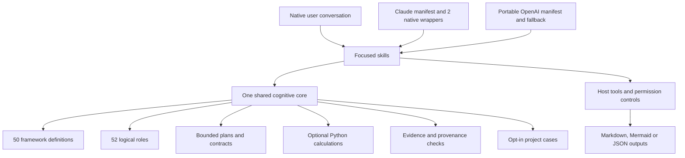

# Unified architecture

**Current implementation:** [HYBRID_ARCHITECTURE.md](HYBRID_ARCHITECTURE.md) describes the V4.1 rebuild / 0.2.0 candidate and native verification limits. The following section preserves the design history and baseline architecture.

**V4.1 target direction:** one Cognitive Core with Claude/Codex adapters, model-selected assistance, event-driven deterministic validation, and conditional deep advisory. The host owns execution and the deliverable; the governor may select `PASS_THROUGH`. See the [target diagram and contracts](CONCEPT_V4_1.md) and [migration plan](V4_1_MIGRATION_PLAN.md).

The following section describes the **3.1 baseline implementation / 0.1.0 package**. It had no hybrid governor or registered hook; this diagram does not represent V4.1 as implemented.

Canonical definitions live only under cognitive-core/frameworks/definitions. The registry is a compact discovery index. Agent metadata references framework IDs instead of defining a separate catalog. Adapters, docs and contracts are generated and checked against canonical resources.

skills/ is discovered by both supported plugin mechanisms. Claude additionally scans agents/ for one reusable read-only specialist and an evaluator. Codex uses actual runtime delegation when available, otherwise logical sequential roles. No root AGENTS.md alters unrelated host work. No hook or MCP endpoint is registered. Python scripts terminate after each operation and never call model APIs or network services.

The five source layers become intake, host orchestration, framework artifacts, validation/calculation, and synthesis/memory/mastery. Source code and input documents stay outside the installable runtime artifact. Source identities and hashes remain in documentation evidence. Packaging includes the common cognitive assets once per installed package.

