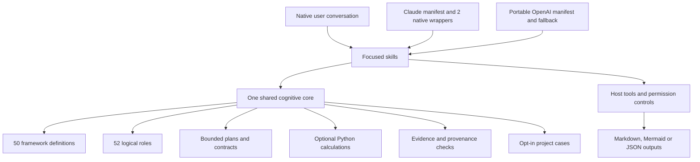

# Unified architecture

**Arah target V4.1:** satu Cognitive Core dengan adapter Claude/Codex, model-selected assistance, event-driven deterministic validation, dan deep advisory kondisional. Host memiliki eksekusi dan deliverable; governor dapat memilih `PASS_THROUGH`. Lihat [diagram dan kontrak target](CONCEPT_V4_1.md) serta [rencana migrasi](V4_1_MIGRATION_PLAN.md).

Bagian berikut mendeskripsikan **implementasi baseline 3.1 / paket 0.1.0**. Belum ada governor hybrid atau hook terdaftar; diagram ini tidak menyatakan V4.1 sudah diimplementasikan.

Canonical definitions live only under cognitive-core/frameworks/definitions. The registry is a compact discovery index. Agent metadata references framework IDs instead of defining a separate catalog. Adapters, docs and contracts are generated and checked against canonical resources.

skills/ is discovered by both supported plugin mechanisms. Claude additionally scans agents/ for one reusable read-only specialist and an evaluator. Codex uses actual runtime delegation when available, otherwise logical sequential roles. No root AGENTS.md alters unrelated host work. No hook or MCP endpoint is registered. Python scripts terminate after each operation and never call model APIs or network services.

The five source layers become intake, host orchestration, framework artifacts, validation/calculation, and synthesis/memory/mastery. Source code and input documents stay outside the installable runtime artifact. Source identities and hashes remain in documentation evidence. Packaging includes the common cognitive assets once per installed package.

