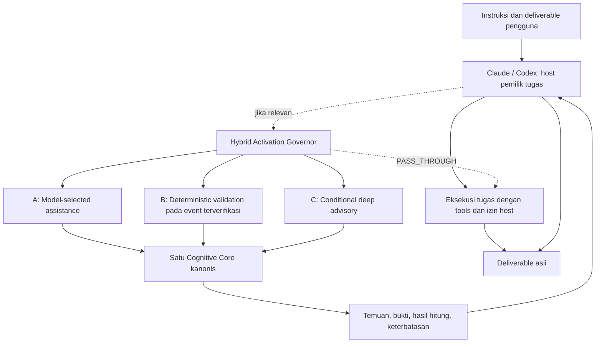

# Kajian perubahan konsep Cognition OS V4.1

Tanggal: 2026-10-20. Status kajian: selesai untuk pembacaan prompt dan perbandingan dengan checkout. Status arsitektur V4.1: `SOURCE_DERIVED` / `PROPOSED`; implementasi hybrid belum dilakukan.

Acuan lengkap: [Master Implementation Prompt V4.1](evidence/master-implementation-prompt-v4.1.txt). Salinan dipertahankan byte-identik, 36.889 byte, SHA-256 `2bea071346bc243cdf6bac965c86d27b7f515278fae0c72817dc462ee5d6b99b`. Metadata: [concept-v4.1.json](evidence/concept-v4.1.json).

Permintaan saat ini adalah mempelajari perubahan konsep dan melakukan proses Git. Kajian ini menetapkan arah pengembangan dan mencatat gap; paket runtime tetap 0.1.0 dengan kontrak 3.1. Nomor spesifikasi tidak menjadi nomor rilis paket secara otomatis.

## Makna perubahan mendasar

Cognition OS menjadi **Hybrid Agent Cognitive Augmentation Layer**. Konsumen utamanya adalah model dan agen yang sedang mengerjakan instruksi manusia. Pengguna tetap meminta hasil kepada Claude atau Codex; host memilih bantuan kognitif yang relevan, menerima temuan terstruktur, dan menyelesaikan deliverable asli.

Repositori ini sudah berupa plugin tanpa aplikasi terpisah. Karena itu perubahan dari 3.1 ke 4.1 terutama menyangkut pemilihan kapabilitas, governor, kontrak advisory, validasi berbasis event, dan evaluasi hasil tugas. Katalog dan helper yang ada dapat digunakan kembali setelah audit kesesuaian.

| Dimensi | Baseline 3.1 pada checkout | Arah V4.1 |
|---|---|---|
| Pemilik tugas | Host sudah menyediakan reasoning dan permission; skill memandu sesi analisis | Host tetap memiliki seluruh eksekusi dan deliverable; plugin memasok bantuan internal |
| Aktivasi | Panduan menonjolkan pemanggilan manual; orchestrator memakai STANDARD jika tanpa preferensi | Model-selected menjadi jalur utama; tugas sederhana dapat lewat tanpa augmentasi |
| Routing | Planner keyword memilih rangkaian framework, termasuk rangkaian umum ketika tidak ada kecocokan | Nilai tambahan, risiko, kompleksitas, bukti, duplikasi, kapabilitas host, dan budget menentukan bantuan |
| Kedalaman | AUTO/QUICK/STANDARD/DEEP/EXECUTIVE/CUSTOM/LEARN sebagai mode workflow | Tujuh kebijakan internal; pengguna tidak perlu memilih mode |
| Validasi | Helper dipanggil secara eksplisit; tidak ada hook | Hook deterministik sempit, hanya pada event yang sudah diverifikasi |
| Advisory mendalam | Orkestrasi dan review tersedia dalam workflow | Dormant, diaktifkan jika pertanyaan analitis dan konsekuensinya membenarkan overhead |
| Output | Orchestrator meminta problem frame, artifact, ledger, verdict, rekomendasi | Temuan ringkas kembali ke host; format deliverable pengguna tetap menentukan |
| Ukuran keberhasilan | Kontrak, hitungan katalog, helper lokal, rencana evaluasi mode | Perbaikan hasil tugas dibanding baseline dan overhead yang benar-benar diukur |

## Arsitektur target dan batas kendali

Diagram berikut adalah rancangan dari prompt, bukan bukti implementasi atau interception runtime.

Satu core digunakan oleh adapter Claude dan Codex. Lokasi kanonis saat ini tetap `cognitive-core/frameworks/` dan `cognitive-core/agents/`; nama folder contoh `mental-models/` dan `specialists/` dalam prompt tidak mewajibkan rename atau salinan kedua.

AG-51 mengoordinasikan analisis yang dipilih di dalam core; peran ini tidak mengambil alih host. AG-52 mengevaluasi temuan dan dapat menolak dukungan atas rekomendasi. Verdict analitis tidak memberi plugin wewenang memblokir tool host. Enforcement hanya berlaku bila ada mekanisme host yang didukung dan sudah diotorisasi.

## Tiga jalur bantuan

| Jalur | Pemicu dan pekerjaan | Batas dan bukti penerimaan |
|---|---|---|
| A — utama | Host memilih skill relevan dan memuat definisi yang diperlukan | Tidak memuat semua 50 definisi, tidak memaksa intake lengkap, tidak menduplikasi analisis host. Instalasi tidak menjamin invocation; evaluasi harus mengamati pemilihan aktual |
| B — sekunder | Event native memicu script lokal untuk format/schema atau artifact tertentu | Verifikasi nama event, payload, izin, feedback, kemampuan block, timeout, dan kegagalan secara terpisah per host. Tidak memanggil LLM pada setiap event |
| C — kondisional | Pertanyaan dengan kompleksitas, risiko, bukti bertentangan, atau kegagalan analisis sebelumnya | Framework komplementer, iterasi terbatas, kalkulasi aktual, temuan ringkas, berhenti saat manfaat tambahan kecil. Panjang jawaban bukan pemicu |

Jalur dapat digabungkan dengan alasan yang jelas untuk setiap tambahan. Tidak ada asumsi akses hidden chain-of-thought, penangkapan semua tahap kerja, event universal, atau kemampuan hook yang seragam pada Claude Code, Chat, Desktop, Cowork dan Codex CLI/Desktop.

Native subagent adalah pilihan implementasi ketika tersedia, diizinkan, dan bermanfaat. Lima puluh dua spesialis berarti 52 spesialisasi analitis logis; tidak berarti 52 proses model, paralelisme otomatis, atau model yang sudah dilatih khusus.

## Hybrid Activation Governor

Governor mempertimbangkan hanya konteks teramati: tujuan, jenis tugas, risiko, kompleksitas, kecukupan bukti, artifact, tools/kapabilitas host, izin, batas eksekusi, konteks tersisa, dan analisis yang sudah dilakukan. Kebijakan target:

| Kebijakan | Perilaku yang dimaksud |
|---|---|
| `PASS_THROUGH` | Tidak menjalankan bantuan tambahan di luar overhead discovery yang tak terhindarkan |
| `LIGHT_AUGMENTATION` | Satu kapabilitas yang sempit dan relevan |
| `STANDARD_AUGMENTATION` | Urutan singkat framework yang saling melengkapi |
| `DETERMINISTIC_VALIDATION` | Tool/hook dengan input dan lingkup terbatas |
| `DEEP_ADVISORY` | Analisis lebih lengkap untuk pertanyaan yang membenarkan biaya |
| `CRITICAL_REVIEW` | Pemeriksaan bukti dan artifact lebih ketat untuk tugas berkonsekuensi besar |
| `DEGRADED` | Memakai kapabilitas yang tersedia saat komponen opsional tidak tersedia |

Ini adalah kebijakan internal, bukan menu wajib pengguna. Belum ada pemetaan satu-ke-satu dari mode lama. Governor harus dapat menjelaskan alasan pemilihan tanpa mengarang skor optimasi, probabilitas risiko, atau estimasi token sebagai pengukuran aktual.

Budget mencakup invocation framework, subagent, putaran debat, tool call, waktu komputasi dan konteks. Saat batas tercapai, kembalikan hasil parsial serta gap material; jangan memberi verdict aman hanya karena perhitungan berhenti. Security enforcement tidak boleh berubah menjadi fail-open melalui `DEGRADED`.

## Transformasi kapabilitas sumber

Tabel ini memetakan seluruh kelompok kapabilitas yang diwajibkan V4.1 ke aset repo dan peran target. Audit lengkap ulang dokumen A/B, setiap formula, dan semua kontrak tetap menjadi gate Phase 0. [Audit sebelumnya](SOURCE_ANALYSIS.md) dipertahankan sebagai catatan 3.1; PDF 15 halaman tidak diinspeksi ulang dalam kajian ini.

| Kapabilitas sumber | Aset baseline | Transformasi target V4.1 |
|---|---|---|
| 50 mental models / delapan kategori | `cognitive-core/frameworks/registry.json`, `definitions/`, `schemas/framework-output/` | Knowledge resource dan skill lazy-loaded; audit precondition, trigger, input/output, metode, bukti, limitasi, kompatibilitas, referensi, validasi per model |
| 52 logical specialists | `cognitive-core/agents/registry.json`, dua wrapper di `agents/` | Peran host, skill, helper deterministik, atau native subagent sesuai kebutuhan; AG-01..52 tetap stabil |
| Framework Stack Builder | `skills/framework-composer/`, `cognition/engine.py` | Routing komplementer untuk celah tugas host; tidak otomatis membuat workflow panjang |
| Problem Ingestion | `skills/cognition-orchestrator/` | Normalisasi konteks teramati; tanya hanya prasyarat yang benar-benar menghalangi |
| Thinking Canvas | `templates/issue-tree.md`, output Markdown/Mermaid/JSON | Artifact pendukung opsional di dalam hasil host ketika membantu; tanpa aplikasi wajib |
| Adversarial Debate | `skills/adversarial-review/`, `references/REVIEW.md`, AG-52 | Advocate, Challenger dan Jury dalam deep advisory terbatas; simpan ketidaksetujuan jika bukti kurang |
| Scenario Simulation | `cognition/mathematics.py`, `references/CALCULATIONS.md` | Tool lokal dengan input/distribusi/seed eksplisit; hasil simulasi diberi kelas bukti tersendiri |
| Logic Guardrails | `cognition/engine.py`, schema evidence, `references/REVIEW.md` | Validasi deterministik bila objektif, review kualitatif bila semantik; potensi hook sempit |
| Mathematical Validation | `cognition/mathematics.py`, `tests/test_mathematics.py` | Kalkulasi aktual dan referensi independen, unit dan asumsi jelas |
| Reasoning Knowledge Graph | `schemas/provenance.schema.json`, `docs/DECISION_PROVENANCE.md` | Graph lineage artifact/bukti/keputusan yang dapat diamati; tanpa akses pikiran tersembunyi |
| Institutional Memory | `cognition/memory.py`, `references/MEMORY.md` | Reuse lokal/host-native yang diotorisasi, provenance dan versi; tanpa database server wajib |
| Executive Synthesis | `skills/executive-synthesis/`, `templates/executive-brief.md` | Sintesis sesuai format host/pengguna; format eksekutif bila relevan |
| Human Mastery Track | `skills/cognitive-mastery/`, `cognitive-core/mastery/` | Pembelajaran manusia opsional dan terpisah; tidak dianggap training otomatis model |

Framework orchestration, guardrails, dan mathematical validation muncul di beberapa kelompok karena dipakai bersama; tidak membuat katalog duplikat. Tidak ada kapabilitas dihapus pada tahap kajian.

## Kontrak advisory dan klasifikasi bukti

Request target memuat, bila tersedia: request ID, host ID, agent role, ringkasan tugas, kapabilitas diminta, referensi bukti, constraints, risiko, tools tersedia, budget, dan lingkup otorisasi. Response target memuat status, findings, supporting evidence, issues, computed results, recommendations, confidence limitations, unresolved questions, dan follow-up checks opsional.

Field konseptual ini belum merupakan schema executable. `schemas/agent-envelope.schema.json` saat ini mewajibkan `envelope_version: "3.1"` dan berpusat pada artifact spesialis. Perlu kontrak request/result V4.1 serta aturan kompatibilitas sebelum perubahan versi schema. Jangan mengganti constant versi saja atau memberi label payload lama sebagai V4.1.

V4.1 menggunakan `VERIFIED_FACT`, `SOURCE_SUPPORTED`, `CALCULATED_RESULT`, `SIMULATED_RESULT`, `ASSUMPTION`, `INFERENCE`, `HYPOTHESIS`, `UNKNOWN`. Baseline memakai `USER_ASSUMPTION` dan `MODEL_INFERENCE`. Migrasi harus menyediakan pemetaan eksplisit dua kelas lama ke `ASSUMPTION` / `INFERENCE` sambil menyimpan asal dan aktor pada provenance; schema strict lama tidak menerima enum baru.

Tidak ada confidence score buatan. Perbedaan schema-valid, source-supported, hasil perhitungan, hipotesis, dan hasil uji harus tetap terlihat. Output advisory tidak memuat transkrip debat panjang atau hidden chain-of-thought.

## Gap yang ditemukan pada checkout

| ID | Bukti repo saat kajian | Gap dan tindakan berikutnya |
|---|---|---|
| G01 | `skills/cognition-orchestrator/SKILL.md`: STANDARD default dan empat tahap intake | Tambahkan seleksi tanpa pemanggilan manual, `PASS_THROUGH`, dan intake proporsional |
| G02 | `cognition/engine.py:plan`: fallback empat framework; `MODES` dan batas lama | Governor relevansi/risiko/duplikasi/budget diperlukan; pilihan eksplisit pengguna tetap dihormati |
| G03 | Skill orchestrator menentukan laporan problem frame/artifact/ledger/verdict | Pisahkan advisory internal dari deliverable host; jangan mewajibkan laporan Cognition OS untuk edit kode sederhana |
| G04 | `schemas/agent-envelope.schema.json`: versi 3.1 dan enum bukti lama | Tambahkan request/result target dan strategi kompatibilitas, bukan penggantian paksa semua data lama |
| G05 | Tidak ada `hooks/` / `mcp.json`; `scripts/validate_package.py` mengassert keduanya tidak ada | Buat capability verification per host dan ubah invariant validator secara terarah bila hook dipilih; MCP tetap opsional |
| G06 | `docs/PERFORMANCE_EVALUATION.md`: baseline vs QUICK/STANDARD/DEEP | Tambah eksperimen A/B/C/D, negative controls dan pengukuran deliverable asli |
| G07 | `scripts/build_docs.py`, `build_plugin.py`, `build_catalog.py` menghasilkan baseline | Selaraskan sumber generator sebelum regenerasi; perubahan manual file generated dapat tertimpa |
| G08 | `docs/PROJECT_STATUS.md`: desktop activation dan perilaku native belum terverifikasi | Discovery/install bukan bukti invocation; jalankan evaluasi host sesungguhnya dalam cakupan akun yang sudah diizinkan |

Ketersediaan host/API/hook tidak diverifikasi ulang melalui internet pada kajian konsep ini. [Matriks kompatibilitas sebelumnya](PLATFORM_COMPATIBILITY.md) adalah evidence baseline dengan ruang lingkupnya sendiri, bukan sertifikasi kemampuan V4.1 terkini. Nama `cognition_assess_task` dan tool MCP lain di prompt tetap usulan, bukan API yang sudah tersedia.

## Ukuran keberhasilan dan fallback

| Eksperimen wajib | Konfigurasi |
|---|---|
| A | Host tanpa Cognition OS |
| B | Host dengan model-selected skills |
| C | B ditambah hook deterministik yang benar-benar didukung |
| D | C ditambah deep advisory hanya ketika dibenarkan |

Gunakan tugas coding sederhana, arsitektur kompleks, debugging, insiden database, review keamanan, keputusan strategis, implementasi multi-langkah, dokumentasi, dan matematika. Sertakan negative control tempat plugin seharusnya pasif. Jika hook tidak tersedia pada suatu host, laporkan C/D sebagai tidak tersedia atau parsial beserta sebab; jangan menyebut pemanggilan script manual sebagai hook native.

Ukur correctness/task success, regression, requirement coverage, relevansi pemilihan framework, unnecessary activation, false-positive warning, tool/model calls, token overhead, latency, kualitas artifact/bukti, dan recovery. Instrumentasi tidak tersedia berarti `UNKNOWN`/belum terukur, bukan nol. Timing helper dan passing schema tidak membuktikan peningkatan hasil host.

Skill tidak tersedia: host melanjutkan reasoning native bila cukup. Hook advisory gagal: catat diagnostik dan degradasi sesuai kebijakan. Enforcement keamanan gagal: ikuti perilaku izin host yang terverifikasi. Deep advisory/MCP tidak tersedia: pakai jalur lokal yang didukung dan ungkap keterbatasan material; jangan mengarang hasil hitung.

## Cakupan seluruh bagian prompt

| Bagian V4.1 | Hasil pemahaman / pekerjaan terpetakan |
|---|---|
| 0 | Identitas, satu core, dual adapter, non-interference dan hasil tugas sebagai tujuan |
| 1 | Audit A/B dan transformasi seluruh kapabilitas; audit lama dipertahankan, audit delta dijadwalkan |
| 2 | Arsitektur host-owned dan diagram target dalam kajian ini |
| 3 | Tiga jalur A/B/C dengan prioritas dan batas yang berbeda |
| 4 | Tujuh kebijakan internal governor, relevansi dan pass-through |
| 5 | Katalog 50/52 dipertahankan; eksekusi minimum efektif |
| 6 | Request/result advisory baru dan kompatibilitas envelope 3.1 |
| 7 | Bantuan pada tahap relevan melalui boundary teramati, tanpa interception universal |
| 8 | Workflow software engineering adaptif; pemetaan contoh bukan urutan wajib |
| 9 | Guardrails, kelas bukti dan migrasi enum |
| 10 | Deep advisory terbatas dengan advocate/challenger/jury |
| 11 | Adapter Claude dan matriks event/surface harus diverifikasi resmi |
| 12 | Adapter Codex dan target desktop Windows harus diverifikasi sendiri |
| 13 | MCP opsional, daftar nama tool adalah proposal |
| 14 | Budget framework/delegasi/debat/tool/waktu/konteks dan early stop |
| 15 | QA pada deliverable nyata; schema/score tidak membuktikan correctness |
| 16 | Tujuan, izin, scope dan output pengguna tetap menjadi batas |
| 17 | Fallback eksplisit, advisory versus security enforcement dibedakan |
| 18 | Memory opt-in; Observe → Evaluate → Propose → Test → Approve → Version; mastery opsional |
| 19 | Struktur direktori konseptual; satu core, file sesuai dukungan aktual |
| 20 | Evaluasi A/B/C/D dengan negative control dan overhead terukur |
| 21 | Roadmap Phase 0–8 di [rencana migrasi](V4_1_MIGRATION_PLAN.md) |
| 22 | Delapan belas kriteria rilis menjadi gate bukti, belum dinyatakan lulus |
| 23 | Status source/proposal/implementasi/verifikasi/testing/support/blocker tetap dibedakan |
| 24 | Paket deliverable A–G dipetakan dalam rencana migrasi |
| 25 | Kajian dan rencana baru memakai Bahasa Indonesia; identifier teknis dipertahankan |
| 26 | Urutan implementasi dicatat sebagai pekerjaan berikutnya, sesuai cakupan permintaan kajian saat ini |

Langkah berikutnya adalah menyelesaikan audit delta sumber dan verifikasi kapabilitas host, kemudian membuat governor serta kontrak minimum. [Rencana migrasi](V4_1_MIGRATION_PLAN.md) memuat urutan dan gate yang dapat ditinjau sebelum perubahan runtime.
